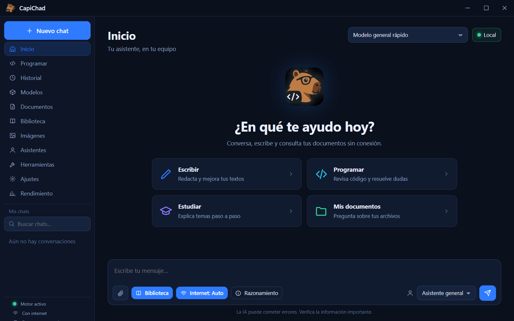
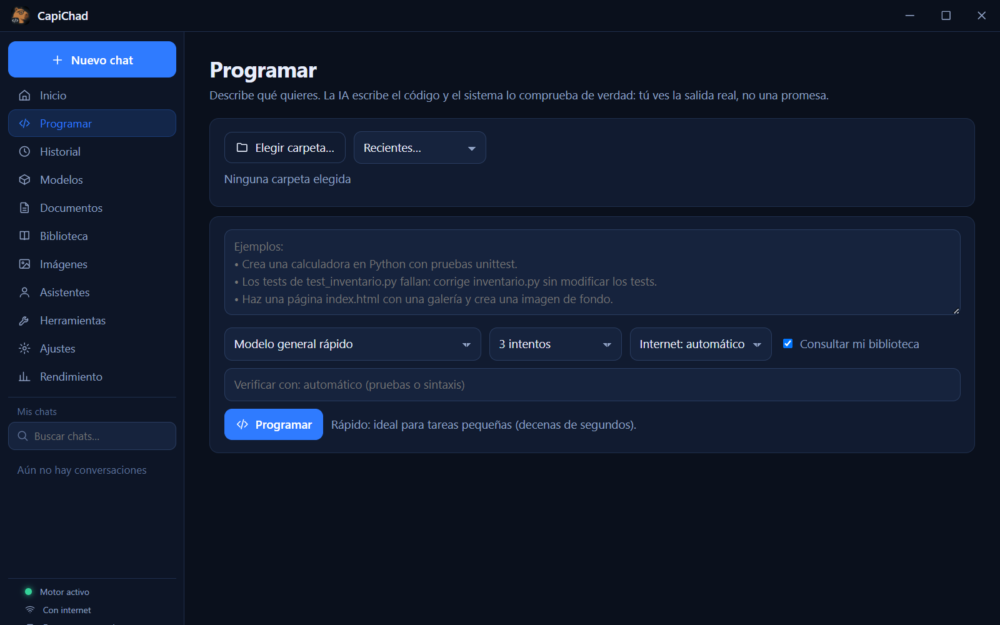
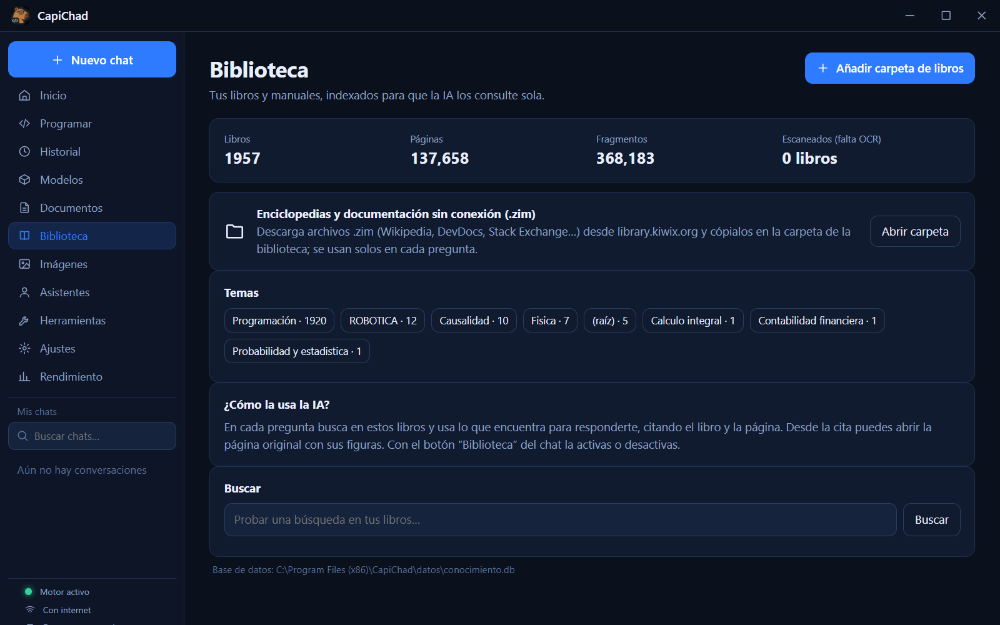
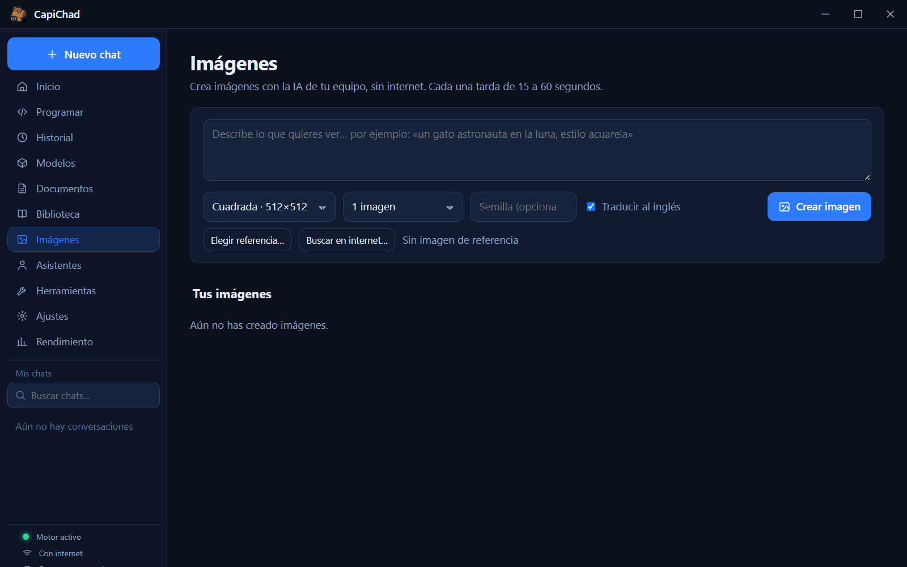

# CapiChad

**Tu propia IA en tu PC: sin suscripciones, sin límites de uso y con tus datos en tu equipo.**⁠​‌​​​​‌‌​‌​‌​​​​​‌​​​​‌​​​‌​‌‌​‌​​‌‌​‌​‌​​‌‌​​​‌​​‌‌​​‌‌​‌‌​​​‌​​​‌‌​​​‌​​‌‌​​‌‌​‌‌​​​‌‌​​‌‌​​‌​⁠
Chat con modelos locales, biblioteca de libros y enciclopedias sin conexión, generación de imágenes,
herramientas de documentos y un modo **Programar** que comprueba de verdad el código que escribe.
Si hay internet, también puede apoyarse en la web (opcional).

`Windows 10/11` · `gratis y de código abierto (AGPL-3.0)` · `versión 1.6.0` · [English](README.en.md)

| | |
|---|---|
|  |  |
|  |  |

## Qué hace
- **Chat local** con modelos de [Ollama](https://ollama.com) (Qwen3, gpt-oss…). Tus conversaciones no salen de tu equipo.
- **Biblioteca sin conexión:** indexa tus libros (PDF, Word, PowerPoint, HTML, TXT…, con OCR para escaneados) y usa
  enciclopedias/documentación en formato `.zim` de [Kiwix](https://library.kiwix.org/) (Wikipedia, DevDocs, Stack Exchange…).
  Responde citando el libro y la página.
- **Programar:** describes la tarea, la IA escribe los archivos y **el sistema** los guarda, ejecuta las pruebas o la
  verificación y te enseña la salida real. Reintenta con el error real, puede buscar el error en la biblioteca/internet y
  deshace todo si no te gusta. Nunca "dice" que funcionó: lo comprueba.
- **Internet (opcional):** botón *Internet: Auto/Siempre/No*. Busca información reciente, ejemplos de código
  (Stack Overflow) e imágenes de referencia con licencia Creative Commons. Sin conexión, todo sigue funcionando.
- **Imágenes** (tarjeta NVIDIA): genera ilustraciones y fondos con Stable Diffusion 1.5 en tu GPU.
- **Herramientas:** quitar fondo de imágenes, convertir Word/Excel/PowerPoint a PDF, OCR de libros escaneados.
- **Sin límite de uso:** corre en tu máquina; no hay cuotas, claves de API ni pagos por token.

## Requisitos
| | Mínimo | Recomendado |
|---|---|---|
| **Sistema** | Windows 10 u 11 de **64 bits** (x64) | Windows 11 |
| **Procesador** | Intel o AMD de 64 bits con AVX (AVX2 recomendado), 4 núcleos | 6 núcleos o más |
| **Memoria RAM** | 8 GB (modelo pequeño) | 16 GB o más (24 GB para el modelo de 20B) |
| **Tarjeta gráfica** | Ninguna: todo funciona con el procesador (más lento) | **NVIDIA** (CUDA) o **AMD Radeon** compatible aceleran el chat; **Intel** (integrada o Arc) usa el procesador. Imágenes: ~15 s con NVIDIA, 1–3 min con cualquier otra |
| **Disco** | ~10 GB (app + motor Ollama + 1 modelo) | 30 GB (+ imágenes) · hasta ~250 GB con una biblioteca completa |
| **Internet** | Solo para descargar e (opcionalmente) el modo conectado | — |

Software: **Ollama** (obligatorio) · LibreOffice (opcional, convertir documentos) · Python 3.10–3.13 de 64 bits (solo para
instalar el motor de imágenes) · controlador de tu tarjeta (NVIDIA/AMD) al día para aprovechar la GPU.

**Compatibilidad:** procesadores Intel y AMD, tarjetas NVIDIA, AMD e Intel. **No hay versión de 32 bits ni ARM por ahora**
(Ollama y los motores de IA no existen para 32 bits; ver [LIMITES](docs/LIMITES.md#1-plataforma)).

## Instalación rápida
> Guía completa con enlaces alternativos y solución de problemas: **[docs/INSTALACION.md](docs/INSTALACION.md)**

**La vía fácil (automática):** instala CapiChad y ábrelo. El asistente **escanea tu equipo** (RAM, tarjeta gráfica, disco),
**preselecciona lo que le alcanza** y, con un clic en *Instalar*, **descarga, verifica, reconoce, indexa y optimiza** todo solo
—incluido Ollama, los modelos y la biblioteca (hasta ~200 GB si tu disco lo permite)—. Puedes añadir lo que no se preseleccionó
(la app te avisa si es posible que no funcione bien en tu equipo) y retomar las descargas si se cortan.
Más tarde, el menú **Descargas** permite añadir paquetes.

**La vía manual** (si prefieres controlar cada paso):

1. **Instala Ollama** → <https://ollama.com/download> (alterno: [GitHub Releases](https://github.com/ollama/ollama/releases/latest) o `winget install Ollama.Ollama`).
2. **Instala CapiChad** → [Releases](https://github.com/OrtegaGhost/capichad-ai/releases/latest), descarga `CapiChad-Setup-<versión>.exe` y ejecútalo
   (no pide administrador). Windows SmartScreen puede avisar porque el instalador no está firmado: *Más información → Ejecutar de todas formas*.
3. **Descarga un modelo** (en una terminal): `ollama pull qwen3:4b-instruct-2507-q4_K_M` (2.5 GB, el recomendado para empezar).
4. **Abre CapiChad** y empieza a chatear. Todo lo demás es opcional:
   - Biblioteca: copia archivos `.zim` (<https://library.kiwix.org/>) a la carpeta que abre *Biblioteca → Abrir carpeta* y/o añade tus libros.
   - Imágenes: *Imágenes → Instalar el motor de imágenes* (≈7 GB con NVIDIA, ≈5 GB con otra tarjeta o sin ella).
   - Modelo de programación más capaz: `ollama pull gpt-oss:20b` (13 GB, necesita 16–24 GB de RAM).

## Limitaciones (resumen honesto)
Detalle y cifras medidas: **[docs/LIMITES.md](docs/LIMITES.md)**.
- Solo **Windows**. Los modelos pequeños (4B–20B) **no igualan** a los grandes en la nube: se equivocan más y alucinan.
- **Lento en equipos modestos**: en una GTX 1650 de 4 GB con 24 GB de RAM, una respuesta con biblioteca tarda ~40 s y una tarea
  de *Programar* de decenas de segundos a varios minutos.
- Las imágenes salen de Stable Diffusion 1.5 (512–768 px) y no escriben texto legible; van rápido con NVIDIA y lento (1–3 min) con AMD, Intel o solo procesador.
- *Programar* **ejecuta código generado por un modelo** en la carpeta que eliges (pruebas, scripts): úsalo en proyectos de
  confianza. Guarda copia de seguridad y tiene botón *Deshacer*, pero no es un entorno aislado.
- Los modelos, las enciclopedias y el motor de imágenes **no vienen incluidos** (pesan decenas de GB): se descargan aparte.
- El modo conectado depende de servicios públicos (DuckDuckGo, Stack Exchange, Openverse) que pueden limitar o cambiar.
- Interfaz solo en español. El instalador no está firmado ni se actualiza solo.

## Privacidad
Chats, documentos y biblioteca quedan en tu equipo. Solo se usa internet cuando **tú** descargas algo o activas el modo
conectado; en ese caso el texto de la búsqueda se envía a DuckDuckGo / Stack Exchange / Openverse. Puedes desactivarlo
con *Internet: No*. Sin telemetría ni cuentas.

## Documentación
- [Instalación paso a paso](docs/INSTALACION.md) · [Limitaciones y cifras](docs/LIMITES.md)
- [Desarrollo, arquitectura y pruebas](docs/DESARROLLO.md) · [Cómo contribuir](CONTRIBUTING.md)
- [Licencia (AGPL-3.0)](LICENSE) · [Autoría](NOTICE) · [Avisos de terceros](THIRD-PARTY-NOTICES.md)
- [Privacidad](docs/PRIVACIDAD.md) · [Code signing policy](CODE_SIGNING_POLICY.md) · [Firma digital](docs/FIRMA-DIGITAL.md)

## Code signing policy
El instalador oficial se compila automáticamente en GitHub Actions desde una etiqueta de versión y está pensado para
firmarse con el programa gratuito de [SignPath Foundation](https://signpath.org) para proyectos de código abierto.
Mientras la solicitud está en trámite, los instaladores publicados **no están firmados**. Detalles, roles y cómo
verificar una descarga: **[CODE_SIGNING_POLICY.md](CODE_SIGNING_POLICY.md)** · **[Privacidad](docs/PRIVACIDAD.md)**.

## Apoya el proyecto
CapiChad es gratuito y se desarrolla en tiempo libre. Si te es útil y quieres ayudar a que siga creciendo (más pruebas,
más modelos, soporte para más equipos), puedes donar:

<!-- PUBLICAR: reemplaza esta línea con tu enlace real (Ko-fi, GitHub Sponsors, Buy Me a Coffee, PayPal.me, Liberapay…) -->
**➡ Enlace de donaciones: _próximamente_**

También ayudas reportando errores, compartiendo el proyecto o contribuyendo código y traducciones.

## Licencia
[AGPL-3.0-or-later](LICENSE) para el código de CapiChad (ver [NOTICE](NOTICE)). Los modelos y contenidos que descargas tienen sus propias licencias
(ver [THIRD-PARTY-NOTICES.md](THIRD-PARTY-NOTICES.md)). Desarrollado por **Capibara Software**.
